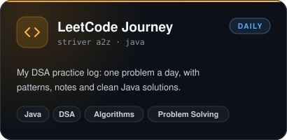
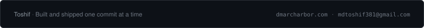

<!-- ===================== HEADER ===================== -->
<div align="center">


<br/>

<a href="https://dmarcharbor.com"></a>
<a href="https://linkshift.in"></a>
<a href="mailto:mdtoshif381@gmail.com"></a>


</div>

<!-- ===================== ABOUT ===================== -->
## 🧑‍💻 About Me

I'm **Toshif**, a full-stack developer from **India** who likes taking products from a blank repo to a live URL. I build with **TypeScript, React / Next.js and Node.js**, and I handle the parts after `git push` too: **Docker, AWS, Cloudflare and CI/CD**.

Right now I'm building **[DMARC Harbor](https://dmarcharbor.com)**, an email-security SaaS that helps MSPs and agencies get every client domain to `p=reject` safely.

```ts
const toshif = {
  role:      "Full-Stack Developer",
  location:  "India 🇮🇳",
  shipping:  ["dmarcharbor.com", "linkshift.in", "arcostudio.co.in"],
  frontend:  ["React", "Next.js", "TypeScript", "Tailwind CSS"],
  backend:   ["Node.js", "Express", "Prisma", "PostgreSQL", "Redis"],
  cloud:     ["AWS", "Docker", "Cloudflare Workers", "GitHub Actions"],
  practice:  "One DSA problem a day, in Java",
  openTo:    ["Internships", "Freelance", "Open source"],
};
```

> *"Not knowing something isn't a roadblock, it's an excuse to master it."*

<!-- ===================== PROJECTS ===================== -->
## 🚀 Featured Projects

<div align="center">

<a href="https://dmarcharbor.com">
  
</a>

<a href="https://dmarcharbor.com"></a>
<a href="https://github.com/toshifdotdev/dmarcharbor"></a>

<br/><br/>

<a href="https://linkshift.in"></a>
<a href="https://arcostudio.co.in"></a>
<a href="https://github.com/toshifdotdev/AegisLease"></a>
<a href="https://github.com/toshifdotdev/leetcode-journey"></a>

<sub>
Source:
<a href="https://github.com/toshifdotdev/LinkShift">LinkShift</a> ·
<a href="https://github.com/toshifdotdev/arco-studio-web">ARCO Studio</a> ·
<a href="https://github.com/toshifdotdev/AegisLease">AegisLease</a> ·
<a href="https://github.com/toshifdotdev/leetcode-journey">LeetCode Journey</a>
</sub>

</div>

<!-- ===================== TECH STACK ===================== -->
## 🛠️ Tech Stack

<div align="center">

<sub><b>FRONTEND</b></sub><br/>


<sub><b>BACKEND &amp; DATA</b></sub><br/>


<sub><b>CLOUD &amp; DEVOPS</b></sub><br/>


<sub><b>LANGUAGES &amp; TOOLS</b></sub><br/>


</div>

<!-- ===================== STATS ===================== -->
## 📊 GitHub Stats

<div align="center">
  <picture>
    <source media="(prefers-color-scheme: dark)" srcset="https://github-profile-summary-cards.vercel.app/api/cards/stats?username=toshifdotdev&theme=github_dark"/>
    <source media="(prefers-color-scheme: light)" srcset="https://github-profile-summary-cards.vercel.app/api/cards/stats?username=toshifdotdev&theme=default"/>
    
  </picture>
  <picture>
    <source media="(prefers-color-scheme: dark)" srcset="https://github-profile-summary-cards.vercel.app/api/cards/repos-per-language?username=toshifdotdev&theme=github_dark"/>
    <source media="(prefers-color-scheme: light)" srcset="https://github-profile-summary-cards.vercel.app/api/cards/repos-per-language?username=toshifdotdev&theme=default"/>
    
  </picture>
</div>

<div align="center">
  <picture>
    <source media="(prefers-color-scheme: dark)" srcset="https://streak-stats.demolab.com?user=toshifdotdev&theme=github-dark-blue&hide_border=true&background=0D1117"/>
    <source media="(prefers-color-scheme: light)" srcset="https://streak-stats.demolab.com?user=toshifdotdev&theme=default&hide_border=true"/>
    
  </picture>
</div>

<div align="center">
  
</div>

<div align="center">
  <picture>
    <source media="(prefers-color-scheme: dark)" srcset="https://raw.githubusercontent.com/toshifdotdev/toshifdotdev/output/github-snake-dark.svg"/>
    <source media="(prefers-color-scheme: light)" srcset="https://raw.githubusercontent.com/toshifdotdev/toshifdotdev/output/github-snake.svg"/>
    
  </picture>
</div>

<!-- ===================== CONNECT ===================== -->
## 🤝 Let's Connect

<div align="center">

I'm open to **internships, freelance projects and open-source collaboration**. My inbox is always open.

<a href="mailto:mdtoshif381@gmail.com"></a>
<a href="https://dmarcharbor.com"></a>
<a href="https://linkshift.in"></a>
<a href="https://github.com/toshifdotdev/leetcode-journey"></a>
<!-- Add when ready:
<a href="https://linkedin.com/in/YOUR_HANDLE"></a>
<a href="https://leetcode.com/u/YOUR_HANDLE"></a>
-->

</div>

<!-- ===================== FOOTER ===================== -->

