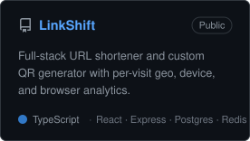
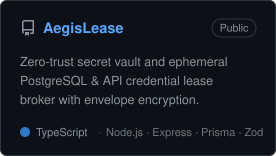
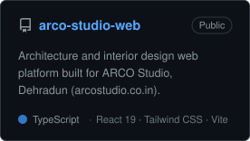

<!-- ===================== HEADER ===================== -->

<!-- ===================== ABOUT ===================== -->
## 🧑‍💻 About Me

I'm **Toshif**, a **Full-Stack Developer** based in **India**, specializing in **TypeScript**, the **MERN stack**, and **Cloud & DevOps**. I take products from idea to deployment — crafting responsive React & Next.js interfaces, engineering robust Node.js & PostgreSQL backends, and automating delivery through CI/CD pipelines.

- 🔭 **Currently building** — [**DMARC Harbor**](https://dmarcharbor.com), a multi-tenant email authentication & DMARC monitoring SaaS for MSPs
- ☁️ **Cloud & DevOps** — **Docker · GitHub Actions · AWS · Cloudflare** for production deployments
- 🧩 **Daily discipline** — solving DSA problems in [`leetcode-journey`](https://github.com/toshifdotdev/leetcode-journey)
- 🤝 **Open to** — internships, freelance work & open-source collaboration
- 📫 **Contact** — [mdtoshif381@gmail.com](mailto:mdtoshif381@gmail.com)

> *"Not knowing something isn't a roadblock, it's an excuse to master it."*

<!-- ===================== PROJECTS ===================== -->
## 🚀 Featured Projects

  <a href="https://dmarcharbor.com"><b>🌐 Live Site (dmarcharbor.com)</b></a> &nbsp;·&nbsp;
  <a href="https://github.com/toshifdotdev/dmarcharbor"><b>💻 Source Code</b></a>

  

  <a href="https://github.com/toshifdotdev/LinkShift">LinkShift Repo</a> &nbsp;·&nbsp;
  <a href="https://github.com/toshifdotdev/AegisLease">AegisLease Repo</a> &nbsp;·&nbsp;
  <a href="https://github.com/toshifdotdev/arco-studio-web">ARCO Studio Repo</a> &nbsp;·&nbsp;
  <a href="https://arcostudio.co.in">arcostudio.co.in ↗</a>

<!-- ===================== TECH STACK ===================== -->
## 🛠️ Tech Stack

**Frontend**

**Backend & Databases**

**Cloud & DevOps**

**Languages & Tools**

<!-- ===================== STATS ===================== -->
## 📊 GitHub Statistics

  <picture>
    <source media="(prefers-color-scheme: dark)" srcset="https://github-profile-summary-cards.vercel.app/api/cards/stats?username=toshifdotdev&theme=github_dark"/>
    <source media="(prefers-color-scheme: light)" srcset="https://github-profile-summary-cards.vercel.app/api/cards/stats?username=toshifdotdev&theme=default"/>
    
  </picture>
  <picture>
    <source media="(prefers-color-scheme: dark)" srcset="https://github-profile-summary-cards.vercel.app/api/cards/repos-per-language?username=toshifdotdev&theme=github_dark"/>
    <source media="(prefers-color-scheme: light)" srcset="https://github-profile-summary-cards.vercel.app/api/cards/repos-per-language?username=toshifdotdev&theme=default"/>
    
  </picture>

  <picture>
    <source media="(prefers-color-scheme: dark)" srcset="https://github-profile-summary-cards.vercel.app/api/cards/most-commit-language?username=toshifdotdev&theme=github_dark"/>
    <source media="(prefers-color-scheme: light)" srcset="https://github-profile-summary-cards.vercel.app/api/cards/most-commit-language?username=toshifdotdev&theme=default"/>
    
  </picture>
  <picture>
    <source media="(prefers-color-scheme: dark)" srcset="https://github-profile-summary-cards.vercel.app/api/cards/productive-time?username=toshifdotdev&theme=github_dark&utcOffset=5.5"/>
    <source media="(prefers-color-scheme: light)" srcset="https://github-profile-summary-cards.vercel.app/api/cards/productive-time?username=toshifdotdev&theme=default&utcOffset=5.5"/>
    
  </picture>

  <picture>
    <source media="(prefers-color-scheme: dark)" srcset="https://streak-stats.demolab.com?user=toshifdotdev&theme=github-dark-blue&hide_border=true"/>
    <source media="(prefers-color-scheme: light)" srcset="https://streak-stats.demolab.com?user=toshifdotdev&theme=default&hide_border=true"/>
    
  </picture>

<!-- ===================== ACTIVITY ===================== -->
## 📈 Contribution Activity

  <picture>
    <source media="(prefers-color-scheme: dark)" srcset="https://github-profile-summary-cards.vercel.app/api/cards/profile-details?username=toshifdotdev&theme=github_dark"/>
    <source media="(prefers-color-scheme: light)" srcset="https://github-profile-summary-cards.vercel.app/api/cards/profile-details?username=toshifdotdev&theme=default"/>
    
  </picture>

  <picture>
    <source media="(prefers-color-scheme: dark)" srcset="https://raw.githubusercontent.com/toshifdotdev/toshifdotdev/output/github-snake-dark.svg"/>
    <source media="(prefers-color-scheme: light)" srcset="https://raw.githubusercontent.com/toshifdotdev/toshifdotdev/output/github-snake.svg"/>
    
  </picture>

<!-- ===================== CONNECT ===================== -->
## 🤝 Connect With Me

<!-- ===================== FOOTER ===================== -->

  

 

